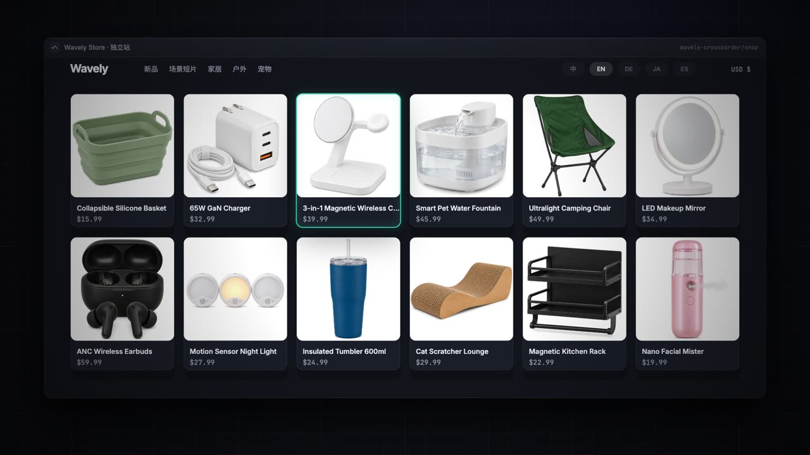
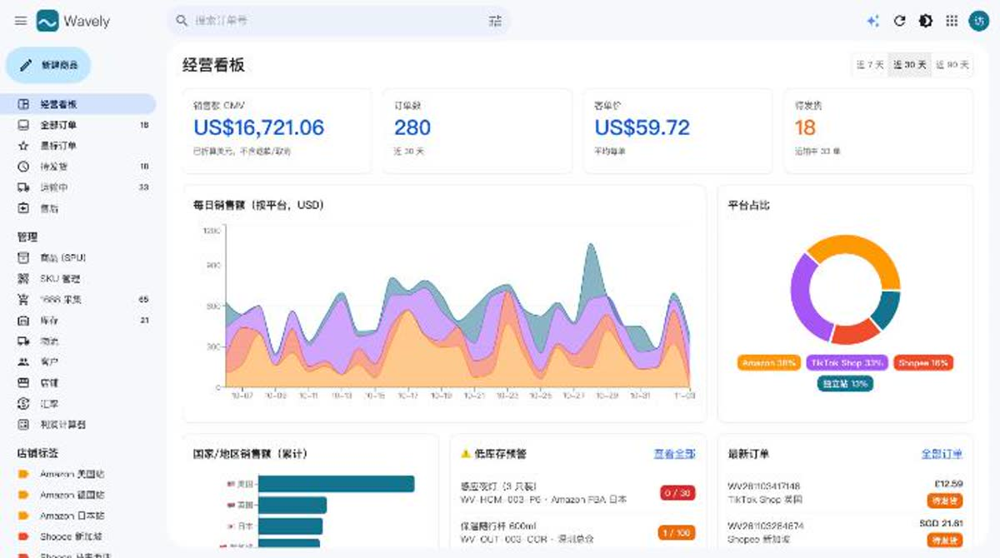
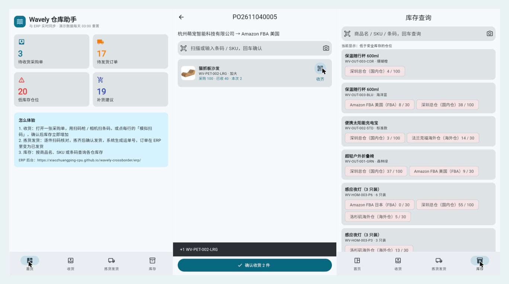
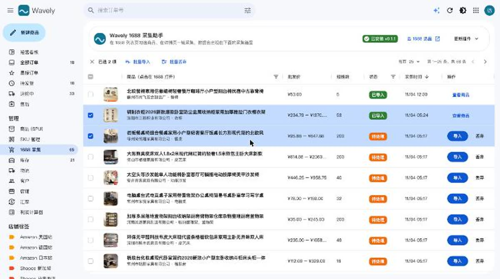
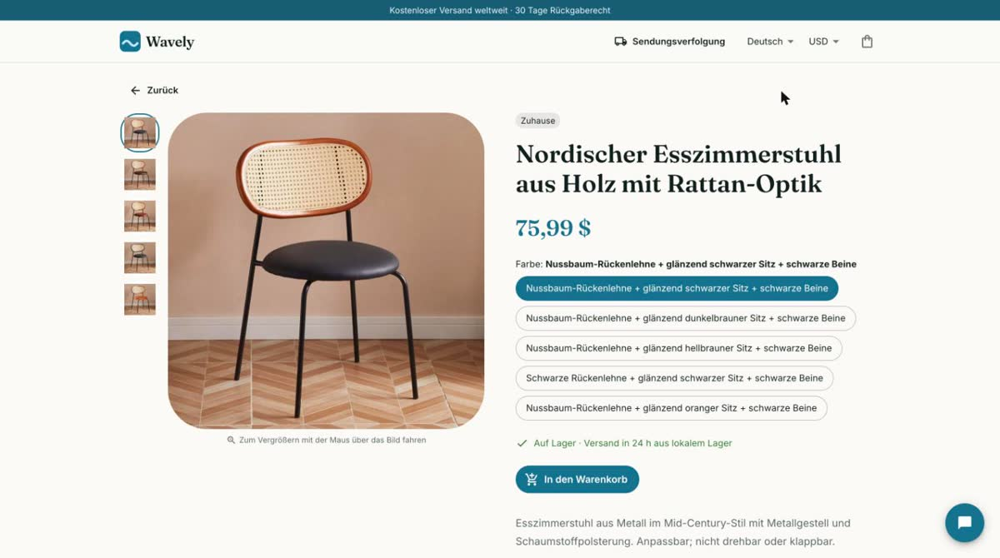

# Wavely — Cross-border E-commerce, End to End

[](https://github.com/xiaozhuangping-cpu/wavely-crossborder/actions/workflows/deploy.yml)
[](https://github.com/xiaozhuangping-cpu/wavely-crossborder/releases/tag/app-latest)
[](LICENSE)
[](https://xiaozhuangping-cpu.github.io/wavely-crossborder/)

**English** · [简体中文](README.md)

[](https://xiaozhuangping-cpu.github.io/wavely-crossborder/promo/wavely-promo.mp4)

An open-source, end-to-end demo of a cross-border e-commerce business for a fictional brand, "Wavely": **ERP back office + 5-language storefront + Flutter warehouse app + 1688 product collector + AI assistants + marketplace listing export**. The whole backend runs on Supabase's free tier, and demo data resets every day, so feel free to click around and change things.

▶ **[One-minute promo film](https://xiaozhuangping-cpu.github.io/wavely-crossborder/promo/wavely-promo.mp4)**: collect from 1688 → AI localization → list in five languages → order → scan & ship → replenishment approval. The film is rendered frame by frame from code (Canvas + synthesized music + AI voice-over); source in [`wavely-promo/`](wavely-promo/).

> The code, demo data and UI were built with AI assistance (Claude Code), planned and published by the author.

| | |
|---|---|
| Demo hub | https://xiaozhuangping-cpu.github.io/wavely-crossborder/ |
| ERP | https://xiaozhuangping-cpu.github.io/wavely-crossborder/erp/ (one-click anonymous guest login) |
| Storefront | https://xiaozhuangping-cpu.github.io/wavely-crossborder/shop/ |
| Warehouse app | https://xiaozhuangping-cpu.github.io/wavely-crossborder/app/ (web build; [Android APK](https://github.com/xiaozhuangping-cpu/wavely-crossborder/releases/download/app-latest/wavely-warehouse.apk)) |

The UI is in Chinese; the storefront also speaks English, German, Japanese and Spanish.


## Features

### 🗂️ ERP



- One inbox for Amazon / Shopee / TikTok Shop / storefront orders (Gmail-style layout), bulk shipping, advanced combined order search
- SPU + multi-variant SKUs, EAN-13 barcodes, domestic / overseas / FBA inventory with safety-stock alerts
- **Marketplace listing export**: select products and generate an importable **Shopify product CSV**, or bulk-listing sheets for **Amazon (US / DE / JP), Shopee and TikTok Shop**. Copy is picked per marketplace language from the multilingual listings, prices are converted at current FX rates, multi-variant products become parent/child rows, and a pre-listing check flags missing translations, over-length titles, missing EANs and zero stock
- Multi-currency (7 rates) profit calculator and live margin estimates
- Product videos uploaded to Supabase Storage with in-browser poster capture
- **✦ AI operations assistant**: ask about sales, find items to restock, write multilingual listings, ship in bulk. Read-only tools run server-side as the visitor (RLS applies); write actions only produce a *proposal* the user must confirm

### 🔐 Roles, approval workflow and audit log

- Three roles: **owner** (everything, approvals), **purchaser** (suppliers, imports, purchase orders), **warehouse** (receiving, shipping)
- **Enforced in the database**: key functions start with `require_role(...)`; the purchase-order tables are read-only and can only be written through functions, so calling the API directly cannot bypass the UI
- Purchase orders above ¥5,000 go to *pending approval*; the owner approves or rejects with a reason
- Every create / submit / approve / reject / receive / ship / role switch is written to an immutable audit log
- Excel export for purchase orders and replenishment suggestions
- Switch roles from the demo's top bar and watch unauthorized actions get rejected; tests cover the allow / deny paths of every role

### 📦 Purchasing and replenishment

- **Replenishment suggestions per SKU × warehouse**: triggered when on-hand + in-transit falls below safety stock; suggested qty = safety stock × 2 + daily sales × lead time (supplier lead time + first-mile: 25 days overseas, 30 days FBA) − on-hand − in-transit, rounded up to the MOQ
- Turn selected suggestions into purchase orders split by supplier × destination warehouse; PO lifecycle draft → placed → partially received → received (or cancelled), with line-by-line partial receiving in one transaction
- Inspired by [ittim-erp](https://github.com/salgee/ittim-erp) and [InvenTree](https://github.com/inventree/InvenTree), re-implemented on Supabase

### 📱 Warehouse app (Flutter)



- Same backend as the ERP: **scan to receive**, **scan-to-pick shipping** (wrong item alerts, tracking number when complete), stock lookup
- One Flutter codebase for Web / Android / iOS; CI tests, builds the web version and publishes the APK. See [`app/README.md`](app/README.md)

### 🧩 1688 collector → collection box



- Chrome / Edge extension (MV3): tick cards on 1688 listing pages across pages, or collect from a product page
- Reads the page's embedded data: title, images, variant dimensions and images, per-variant price / stock / weight, tiered prices, attributes, supplier
- Opens product pages one at a time at a configurable interval; on login or slider checks it **pauses and hands over to the user** — no bypassing
- Price from a target margin (first-mile + last-mile + commission model), pick variants, publish or save as draft
- **Bulk import + AI localization**: product names are trimmed of marketing fluff and translated into zh / en / de / ja / es together with variant names, values and descriptions, creating SPU + SKUs in one transaction

### 🌐 Multilingual storefront

| Home · AI product films | Product page (German, AI-localized collected product) |
|---|---|
|  |  |

- 5 languages, 6 currencies; orders flow into the ERP in real time and tracking advances every hour
- SEO: real path routes, pre-rendered product pages, structured data and a sitemap
- **✦ AI shop assistant**: recommends only products that exist in the catalog, looks up orders and tracking, answers policy questions — read-only

### ✦ AI

| Capability | Notes |
|---|---|
| Tool-calling chat | OpenAI-compatible streaming tool loop (SSE); both assistants share `supabase/functions/_shared/llm.ts` |
| Bring your own model | DeepSeek, Qwen, Kimi, Zhipu, Doubao, SiliconFlow, OpenRouter, OpenAI, Claude, Gemini or a custom endpoint; **own keys don't use the demo quota**, stay in the browser and are never stored; only public https endpoints are allowed (SSRF guard) |
| Quota | Built-in DeepSeek: 30 calls per visitor per day, 1,500 site-wide |
| Product localization | `translate_products`: deduplicates variant values per dimension, aligns results with inputs, falls back to Chinese |
| AI product films | Generated from white-background product shots with Google Flow (Veo 3.1), transcoded to faststart mp4 + poster |

## Architecture

**Business rules live in Postgres.** Ordering, collecting, importing, purchasing and replenishment are Postgres functions and views (`place_order`, `collect_offer`, `import_draft`, `create / place / approve / receive / cancel_purchase_order`, `v_replenishment`). The ERP, storefront, app and AI assistants all call the same functions via `supabase.rpc(...)`, so each rule is written once and cannot be bypassed.

| Concern | Implementation |
|---|---|
| Guest login | Supabase anonymous sign-in, no registration |
| Data access | RLS everywhere: anonymous users read only active products / shops / FX rates; signed-in guests read and write ERP data |
| Privileged writes | `security definer` only where needed (ordering, demo reset), with `execute` revoked from `public` / `anon` |
| RBAC & audit | `user_roles` + `require_role()`; `audit_log` written by `log_action()`, read-only for visitors |
| Media | Public bucket `product-media` (≤ 20 MB, images / video only) |
| Scheduled jobs | `advance_shipments()` hourly and `reset_demo()` daily at 03:00 Beijing time via pg_cron |

```
erp/          ERP (React + react-admin + ra-supabase-core + AG Grid + Recharts + assistant-ui)
shop/         Multilingual storefront (React + MUI + assistant-ui)
app/          Warehouse app (Flutter: Web / Android / iOS)
extension/    1688 collector (Chrome / Edge MV3)
supabase/
  migrations/ Schema, RLS, business functions, demo data, cron jobs
  functions/  ai-assistant (ERP), shop-assistant (storefront), _shared/llm.ts
  tests/      Database tests (run in CI against a Postgres container)
site/         Demo hub
```

## Local development

```bash
cd erp && npm install && npm run dev     # ERP (also packs the extension zip)
cd shop && npm install && npm run dev    # Storefront
```

Extension: enable developer mode in `chrome://extensions` and load `extension/` unpacked. Its version must match `EXTENSION_LATEST` in `erp/src/collect/extension.js` (checked at build time).

## Tests

```bash
DATABASE_URL=postgres://postgres@127.0.0.1:5432/postgres ./supabase/tests/run.sh
```

The script builds a minimal Supabase-like environment in an empty database (roles, auth / storage / cron stubs), applies every migration in order, then runs `supabase/tests/*.sql`. Tests are plain SQL with `assert`, simulating different users through `request.jwt.claims`. CI runs them on every push: **database tests → build ERP / storefront / app → deploy to GitHub Pages**; nothing ships if a test fails.

## Self-hosting

1. **Supabase**: create a project, enable Authentication → Anonymous Sign-ins, then `supabase link --project-ref <your ref>`
2. **Database**: `supabase db push --remote` (all migrations + demo data); enable `pg_cron` under Database → Extensions
3. **AI**: `supabase secrets set DEEPSEEK_API_KEY=...`, then `supabase functions deploy ai-assistant shop-assistant --no-verify-jwt --remote`
4. **Frontend config**: replace the Supabase URL / publishable key and site URLs listed in the [Chinese README](README.md#自部署fork-后用自己的后端)
5. **GitHub Pages**: Settings → Pages → Source: GitHub Actions; pushing `main` tests and deploys

## License

[MIT](LICENSE) — fork it, extend it, use it commercially. Demo data (fictional brand, products, orders), AI-generated product images and films are for demonstration only.

Contributions welcome — see [CONTRIBUTING.md](CONTRIBUTING.md). Please report security issues privately as described in [SECURITY.md](SECURITY.md).

## Author

Full-stack developer focused on cross-border e-commerce systems (ERP, multilingual storefronts, product collection and marketplace listing tools). Open to remote roles and project work — contact details are on the [demo hub](https://xiaozhuangping-cpu.github.io/wavely-crossborder/).
