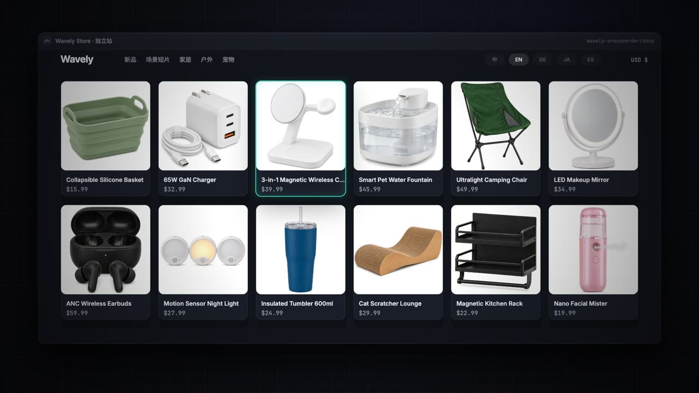
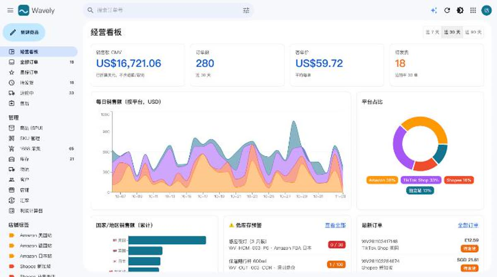
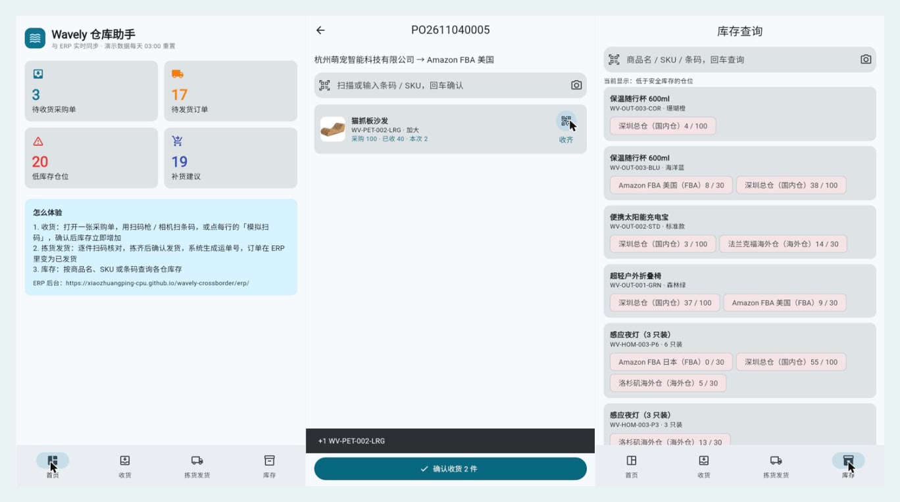
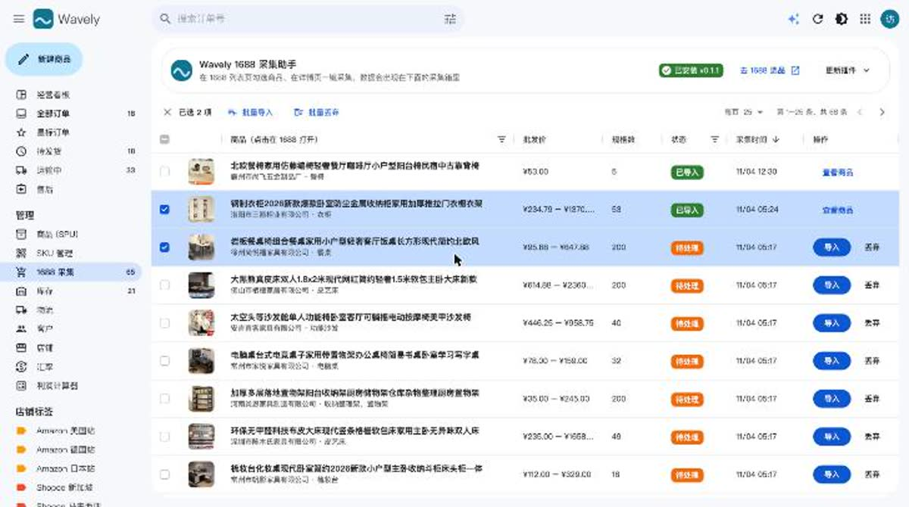
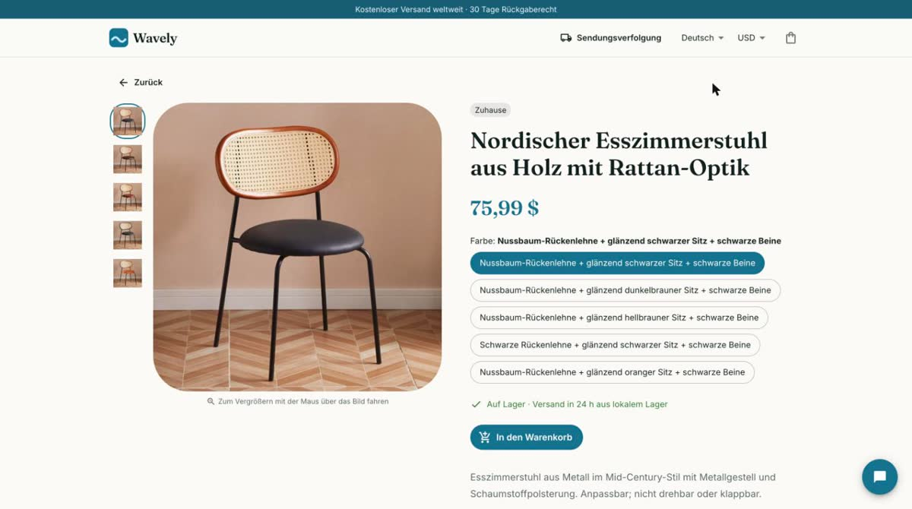

# Wavely 跨境电商演示

[](https://github.com/xiaozhuangping-cpu/wavely-crossborder/actions/workflows/deploy.yml)
[](https://github.com/xiaozhuangping-cpu/wavely-crossborder/releases/tag/app-latest)
[](LICENSE)
[](https://xiaozhuangping-cpu.github.io/wavely-crossborder/)

> **English** · An open-source, end-to-end cross-border e-commerce demo: an ERP (orders, SKUs, multi-warehouse inventory, replenishment & purchasing with approval workflow, database-enforced RBAC, audit log), a 5-language storefront with an AI shopping assistant, a Flutter warehouse app (scan to receive / pick & ship), a Chrome extension that collects products from 1688, AI product localization and AI-generated product films. Built with React, Flutter and Supabase (Postgres + RLS + Edge Functions), tested in CI. [Try it live →](https://xiaozhuangping-cpu.github.io/wavely-crossborder/)

[](https://xiaozhuangping-cpu.github.io/wavely-crossborder/promo/wavely-promo.mp4)

▶ **[一分钟宣传片](https://xiaozhuangping-cpu.github.io/wavely-crossborder/promo/wavely-promo.mp4)**：1688 采集 → AI 本地化 → 五语言上架 → 下单 → 扫码发货 → 补货审批。整支片子由代码逐帧渲染（Canvas + 合成配乐 + AI 配音），源码与一键构建脚本在 [`wavely-promo/`](wavely-promo/)。

虚构品牌「Wavely 海浪优选」的跨境电商全链路演示：**ERP 后台 + 多语言独立站 + 仓库 App + 1688 采集插件 + AI 助手 + AI 场景短片**，后端全部跑在 Supabase 免费版上，数据每天自动重置。

> 本项目的代码、演示数据与界面设计均为 AI 辅助生成（使用 Claude Code），由作者策划与发布。

- 演示入口：https://xiaozhuangping-cpu.github.io/wavely-crossborder/
- 仓库 App：https://xiaozhuangping-cpu.github.io/wavely-crossborder/app/ （Flutter 网页版，另有安卓安装包）
- ERP 后台：https://xiaozhuangping-cpu.github.io/wavely-crossborder/erp/ （访客一键匿名登录）
- 独立站：https://xiaozhuangping-cpu.github.io/wavely-crossborder/shop/


## 功能一览

### 🗂️ 跨境 ERP 后台



- Amazon / Shopee / TikTok Shop / 独立站订单统一管理，Gmail 式收件箱布局，批量发货
- SPU + 多规格 SKU、EAN-13 条码、国内仓 / 海外仓 / FBA 库存与安全库存预警
- 多币种（7 种汇率）利润计算器，商品毛利实时估算
- 商品「视频」标签：上传到 Supabase Storage，浏览器内自动截取封面
- **✦ AI 运营助手**：问销售数据、找补货商品、写多语言 Listing、批量发货。只读工具在服务端以访客身份执行（遵守 RLS），写操作只生成「提案」，用户点确认后才执行

### 🔐 权限角色、审批流与操作日志

- 三种角色：**老板**（全部、审批）、**采购**（供应商、采集导入、创建 / 提交 / 取消采购单）、**仓库**（收货入库、发货）
- **权限在数据库层强制**：关键操作的数据库函数开头 `require_role(...)`，越权直接拒绝；采购单表只读，写入只能经过函数，绕开界面直接调接口也改不了
- **采购审批流**：金额超过 ¥5,000 的采购单由采购提交后进入「待审批」，老板通过后下单，或填写原因驳回退回草稿
- **操作日志**：创建、提交、审批、驳回、收货、发货、切换身份都由数据库函数写入日志（谁、以什么身份、做了什么），任何人不能修改
- **Excel 导出**：采购单（含明细两个工作表）、补货建议导出为 .xlsx
- 演示站顶栏可切换身份，亲手体验越权被拒；数据库测试覆盖每个角色的允许 / 拒绝路径

### 📦 采购闭环与补货

- **补货建议（按 SKU × 仓库）**：在库 + 在途低于安全库存时触发，建议量 = 安全库存 × 2 + 日均销量 × 补货周期（供应商交期 + 头程：海外仓 25 天、FBA 30 天）− 在库 − 在途，按起批量取整
- 勾选建议一键按「供应商 × 收货仓」拆单生成采购单；采购单 草稿 → 已下单 → 部分到货 → 已到货（或取消），按明细分批收货，事务内入库
- 供应商管理（交期、联系人）；1688 导入的商品自动按供应商名关联供应商并记录起批量
- AI 运营助手新增「补货建议」工具：直接问"FBA 仓该补哪些货"
- 设计参考开源项目 [ittim-erp](https://github.com/salgee/ittim-erp)（采购单主表 + 明细、在库 + 在途 < 需求的补货预警）与 [InvenTree](https://github.com/inventree/InvenTree)（采购单状态、按明细分批收货），按本项目的 Supabase 架构重新实现

### 📱 仓库助手 App（Flutter）



- 与 ERP 共用同一个后端的移动端：**扫码收货入库**（扫码枪 / 相机 / 模拟扫码）、**逐件扫码拣货发货**（扫错件会提示，拣齐后生成运单号）、**库存查询**
- 网页版：https://xiaozhuangping-cpu.github.io/wavely-crossborder/app/ · [安卓安装包](https://github.com/xiaozhuangping-cpu/wavely-crossborder/releases/download/app-latest/wavely-warehouse.apk)
- 一套 Flutter 代码出 Web / Android / iOS；CI 自动测试、构建网页版并打包 APK 到 Release「app-latest」。详见 [`app/README.md`](app/README.md)

### 🧩 1688 采集插件 → 采集箱



- Chrome / Edge 插件（MV3）：1688 列表页卡片勾选、跨页累计批量采集；详情页一键采集
- 读取页面内嵌数据：标题、主图、规格维度与规格图、每个规格的价格 / 库存 / 重量、阶梯价、属性、供应商
- 后台逐个打开详情页、间隔可设（默认 1 秒），遇到登录 / 滑块验证**暂停并交给用户处理**，不做绕过
- ERP 采集箱：按目标毛利率反推售价（头程 + 尾程 + 佣金模型）、勾选规格、选择直接上架或存草稿
- **批量导入 + AI 本地化**：商品名精简（去营销词）并翻译为中英德日西，规格名、规格值、描述一并翻译，事务内生成 SPU + SKU
- ERP 内置安装入口：自动检测插件是否安装 / 是否需要更新，提供下载包与三步安装指引

### 🌐 多语言独立站

| 首页 · AI 场景短片 | 商品页（德语 · AI 本地化的采集商品） |
|---|---|
|  |  |

- 中 / 英 / 德 / 日 / 西五种语言、6 种币种，下单实时同步到 ERP，物流轨迹每小时自动推进
- 「颜色 × 尺码」分组选规格、规格多时折叠；亚马逊式商品图放大镜与规格缩略图
- 首页场景短片区块（进入可视区域自动静音播放），商品图集内嵌视频
- **✦ AI 客服**：导购（只推荐目录里真实存在的商品）、查订单物流、政策问答，全程只读

### ✦ AI 能力

| 能力 | 说明 |
|---|---|
| 工具调用对话 | OpenAI 兼容的流式工具调用循环（SSE），两个助手共用 `supabase/functions/_shared/llm.ts` |
| 自带模型 | 访客可切换 DeepSeek、通义千问、Kimi、智谱、豆包、硅基流动、OpenRouter、OpenAI、Claude、Gemini 或自定义接口；**自带 Key 不占演示额度**，Key 只存在浏览器、经服务端转发、不落库；接口地址只允许 https 公网域名（防 SSRF） |
| 配额 | 内置 DeepSeek 每访客每天 30 次、全站 1500 次 |
| 商品本地化 | `translate_products`：按维度去重后翻译规格值，结果按输入对齐，缺译回退中文 |
| AI 场景短片 | 以商品白底图为素材，Google Flow（Veo 3.1）生成，ffmpeg 转码为 faststart mp4 + 封面 |

## 结构

```
erp/                    跨境 ERP（React + react-admin + ra-supabase-core + AG Grid + Recharts + assistant-ui）
  src/collect/          采集箱、插件安装入口、导入与 AI 本地化
  scripts/              构建时把 extension/ 打包成 zip 供 ERP 下载
shop/                   多语言独立站（React + MUI + assistant-ui）
app/                    仓库助手 App（Flutter：Web / Android / iOS）
extension/              1688 采集插件（Chrome / Edge MV3）
supabase/
  migrations/           表结构、RLS、业务函数、演示数据、定时任务
  functions/            ai-assistant（ERP）、shop-assistant（独立站）、_shared/llm.ts
  tests/                数据库函数测试（CI 中用 Postgres 容器跑全部迁移后执行）
site/                   演示入口页
docs/screenshots/       README 截图
```

## 后端（Supabase）

| 能力 | 实现 |
|---|---|
| 访客登录 | 匿名登录（Anonymous Sign-in），无需注册 |
| 权限 | RLS：未登录只能读在售商品 / 店铺 / 汇率；登录访客可读写 ERP 数据 |
| 独立站下单 | `place_order()`（security definer，校验数量与收货信息） |
| 采集与导入 | `collect_offer()` 去重写入采集箱；`import_draft()` 事务内生成 SPU + SKU 并关联供应商 |
| 采购与补货 | `create / place / approve / receive / cancel_purchase_order()`；视图 `v_replenishment` 计算补货建议 |
| 权限与审计 | `user_roles` + `require_role()` 函数级 RBAC；`audit_log` 由 `log_action()` 写入、访客只读 |
| 媒体存储 | 公开桶 `product-media`（≤ 20 MB，仅视频 / 图片） |
| 物流推进 | `advance_shipments()`，pg_cron 每小时执行 |
| 每日重置 | `reset_demo()`，pg_cron 每天北京时间 03:00 执行（含采集箱与演示视频） |
| 保活 | GitHub Actions 每 3 天访问一次，避免免费项目被暂停 |

前端只使用 publishable key（本就设计为公开），数据安全由 RLS 控制。

## 本地开发

```bash
cd erp && npm install && npm run dev     # ERP（同时打包插件 zip）
cd shop && npm install && npm run dev    # 独立站
```

插件开发：在 `chrome://extensions` 打开开发者模式，「加载已解压的扩展程序」选择 `extension/`。插件版本号需与 `erp/src/collect/extension.js` 的 `EXTENSION_LATEST` 一致（构建时校验）。

## 测试

```bash
DATABASE_URL=postgres://postgres@127.0.0.1:5432/postgres ./supabase/tests/run.sh
```

脚本会在一个空库里建好 Supabase 所需的最小环境（角色、auth / storage / cron 替身），按顺序执行全部迁移，再运行 `supabase/tests/*.sql`。CI 中每次推送都会用 Postgres 容器跑一遍。

## 自部署（Fork 后用自己的后端）

1. **Supabase**：新建项目，开启 Authentication → Anonymous Sign-ins；安装 [Supabase CLI](https://supabase.com/docs/guides/cli) 后 `supabase link --project-ref <你的 ref>`
2. **数据库**：`supabase db push --remote`（执行全部迁移并写入演示数据）；在 Database → Extensions 开启 `pg_cron`，迁移会注册物流推进与每日重置任务
3. **AI**：`supabase secrets set DEEPSEEK_API_KEY=...`，然后 `supabase functions deploy ai-assistant shop-assistant --no-verify-jwt --remote`
4. **前端配置**：把下表里的 Supabase 地址 / publishable key 与站点地址换成你自己的
5. **GitHub Pages**：仓库 Settings → Pages → Source 选 GitHub Actions，推送 `main` 即自动测试并发布

| 需要修改的地方 | 内容 |
|---|---|
| `erp/.env`、`shop/.env` | `VITE_SUPABASE_URL`、`VITE_SUPABASE_KEY`（publishable key） |
| `extension/config.js`、`app/lib/config.dart` | 同上，以及 ERP 地址 |
| `extension/manifest.json` | `externally_connectable` 允许的 ERP 域名；如需固定扩展 ID 请换成自己的 `key` |
| `erp/vite.config.js`、`shop/vite.config.js`、`.github/workflows/deploy.yml` | `base` 路径（仓库名不同时） |
| `erp/src/constants.js`、`shop/src/store.jsx`、各 `index.html` | 独立站 / ERP 互链地址与分享卡片地址 |
| `supabase/migrations/*`（演示数据） | 商品图片与演示视频的站点地址 |

## 部署

推送到 `main` 后，GitHub Actions 先跑数据库测试，再构建并发布到 GitHub Pages。

数据库迁移与边缘函数（Supabase CLI v3，需加 `--remote` 指向线上项目）：

```bash
supabase secrets set DEEPSEEK_API_KEY=...
supabase functions deploy ai-assistant shop-assistant --no-verify-jwt --remote
supabase db push --remote
```

> 若本机网络无法直连数据库（直连地址仅 IPv6），可改用走管理接口的 `supabase db query --remote -f <迁移文件>` 执行迁移，并把版本号写入 `supabase_migrations.schema_migrations`。

## 开源协议

代码以 [MIT](LICENSE) 协议开源，欢迎 Fork、二次开发与商用。演示数据（虚构品牌、商品、订单）、AI 生成的商品图与场景短片仅作演示用途。

欢迎参与贡献，见 [CONTRIBUTING.md](CONTRIBUTING.md)；安全问题请按 [SECURITY.md](SECURITY.md) 私下报告。
